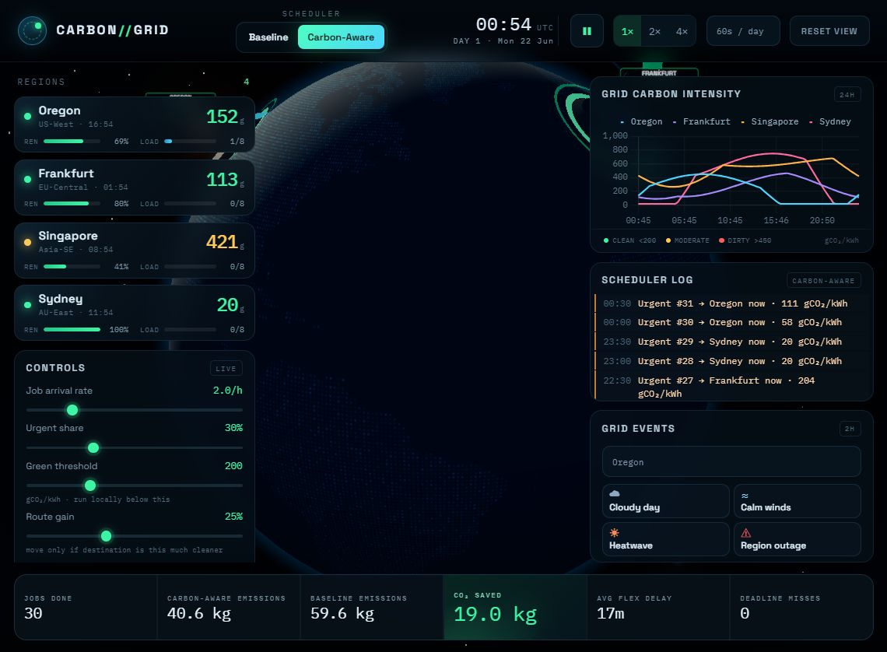

# Carbon // Grid

A browser-based, carbon-aware cloud job scheduler. Two simulated worlds run in
lockstep from the same job stream: a **carbon-blind baseline** that runs work as
soon as a slot is free, and a **carbon-aware** scheduler that shifts flexible
work toward clean grids and clean hours. The 3D globe shows the active world
while the metrics always compare both.

Built with **Vite + Three.js + Chart.js**. No backend, no API keys, no external
image assets.



New here? Click **Guide** in the top bar for an interactive walkthrough, or read
the presenter script in [DEMO.md](DEMO.md).

## Run

```bash
npm install
npm run dev        # Vite prints the local URL (usually http://localhost:5173)
```

Production build and preview:

```bash
npm run build
npm run preview
```

The build is fully static — deploy `dist/` to Vercel, Netlify, Cloudflare
Pages, or any static host. For a sub-path deployment (e.g. GitHub Pages), set
Vite's [`base`](https://vite.dev/config/shared-options.html#base) accordingly.

## What you see

- **3D Earth** — dotted equirectangular land texture generated at runtime,
  atmospheric glow, orbiting sun/terminator, stars, and four data centers
  (Oregon, Frankfurt, Singapore, Sydney) with live load, solar, wind, smoke,
  turbines, and panels.
- **Region cards** — local time, live grid carbon intensity (gCO₂/kWh),
  renewable share, and capacity load. Click a card or a data center on the
  globe to fly the camera and open a 6-hour forecast detail panel.
- **Dual schedulers** — switch between the carbon-aware and baseline worlds at
  any time. The 3D scene and job log follow the active world; the metrics
  compare both.
- **Job visuals** — glowing cubes for queued/running jobs, animated routing
  arcs between regions, delay clocks for deferred work, and completion bursts.
- **Live chart** — 24-hour carbon-intensity history for all four regions.
- **Scheduler log** — run / route / delay / queue / deadline-guard decisions.
- **Metrics** — jobs done, aware vs baseline emissions, CO₂ saved, average
  delay, routing/delay counts, and a deadline-miss counter.
- **Weather events** — cloudy day, calm winds, heatwave, and region outage,
  applied to both worlds for a fair comparison.

## Controls

| Action | Control |
| --- | --- |
| Guided demo | **Guide** button (or first visit) |
| Orbit / zoom | Drag and scroll on the globe |
| Focus a region | Click a region card or its data center |
| Switch world | **Baseline** / **Carbon-Aware** |
| Pause / resume | ❚❚ button or `Space` |
| Change speed | 1× / 2× / 4× |
| Reset | **Reset** button or `R` |
| Reset camera | **Reset view** |
| Add work | **Submit 10 flexible jobs** |
| Tune policy | Arrival rate, urgent share, green threshold, routing gain, day length |
| Inject weather | Event buttons for the selected region |

## Scheduling model

The simulation clock starts at **21 Jun 2026, 14:00 UTC**. Regions have local
time zones, deterministic solar/wind curves, and a live intensity with a small
sensor wobble. The scheduler has a perfect 6-hour forecast and re-checks delayed
jobs every 15 simulated minutes.

Carbon-aware policy:

1. Run locally if the grid is at or below the green threshold and a slot is free.
2. Route if another region is at least `routeGain` cleaner, accounting for a
   20-minute transfer and a 5% energy penalty.
3. Delay if a meaningfully cleaner window is forecast before the deadline.
4. Otherwise run in the cleanest place available now.

**Urgent jobs never wait** and never route for carbon reasons. They run
immediately in the home region, fall back to the cleanest free region, and
oversubscribe briefly if every region is full.

**Deadline guarantee:** every flexible job carries a deadline (2–12 hours).
Before a job gets within `duration + 10 min` of its deadline, a rescue pass
forces it to start, even if that means exceeding regional capacity. As a
result the simulation has **zero deadline misses** across all stress scenarios.

## Project structure

```
src/
  clock.js            simulated clock and time formatting
  regions.js          region definitions, capacities, event types
  grid.js             carbon-intensity model, forecast, weather events
  jobs.js             seeded job factory and deadlines
  scheduler.js        baseline and carbon-aware policies (Three.js-free)
  world.js            per-world state, assignment, completion, deadline guard
  main.js             app bootstrap, loop, scene wiring, interactions
  scene/globe.js      Earth texture, sun, atmosphere, stars
  scene/datacenter.js racks, turbines, panels, smoke, labels, click targets
  scene/jobs3d.js     job cubes, routing arcs, delay clocks, completion effects
  ui/panels.js        cards, metrics, log, detail card, controls
  ui/charts.js        Chart.js carbon-intensity history
  ui/onboarding.js    8-step guided demo used by the Guide button
  assets/land.json    Natural Earth 110m land geometry for the texture
scripts/
  stress.mjs          headless multi-day scheduler stress test
```

`grid.js`, `scheduler.js`, and `world.js` contain no Three.js code, so the
scheduling core can be tested headlessly.

## Tests

```bash
npm run test:stress
```

Runs five multi-day scenarios (calm default, high arrival, extreme arrival,
urgent-heavy, outage-heavy) and asserts:

- zero deadline misses,
- every submitted job eventually completes,
- carbon-aware emissions stay below the baseline.

## Performance note

The production bundle is a single ~940 kB JS chunk (~271 kB gzip), mostly
Three.js and Chart.js. This is expected for a self-contained 3D demo; the build
warning is informational.
